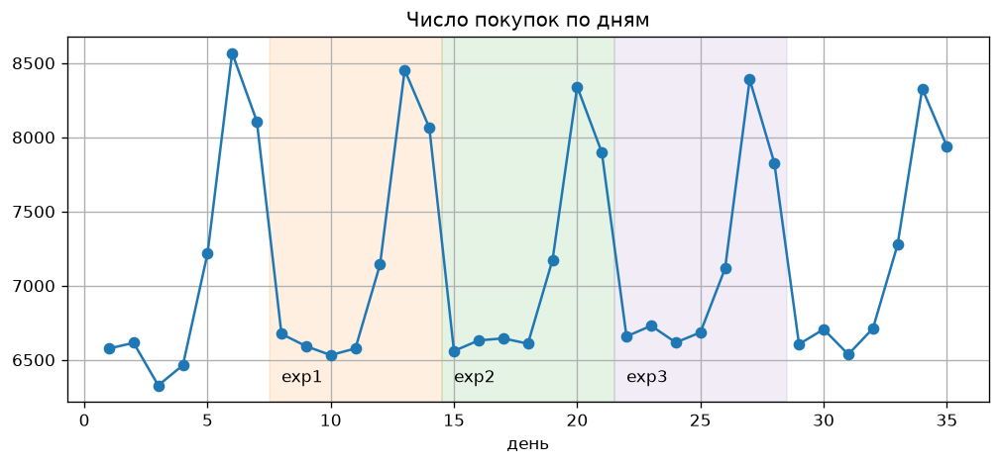
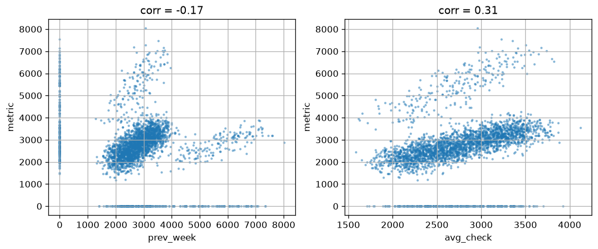
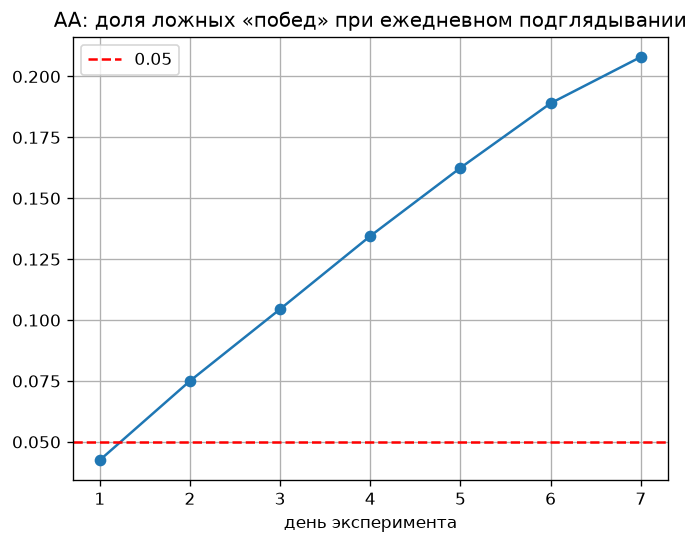

# Оценка A/B-экспериментов интернет-магазина

Разбор трёх недельных экспериментов на данных о продажах: t-test, MDE, CUPED и проблема подглядывания.

Ноутбук: [ab_tests.ipynb](ab_tests.ipynb)

## Данные

- `df_sales.csv` — ~250 тыс. покупок, 50 тыс. пользователей, 35 дней (`user_id`, `cost`, `day`, `time`)
- `exp_dict.json` — дни и состав групп для трёх экспериментов (1 тыс., 12 тыс. и 25 тыс. пользователей в группе)

Данные взяты из учебных материалов курса по A/B-тестированию, в репозиторий не выложены. Чтобы запустить ноутбук, положите оба файла в папку `data/`.

Метрика — выручка с пользователя за неделю эксперимента, уровень значимости 0.05.

## Что сделано

1. Проверила корректность разбиения: сравнила группы на неделе до эксперимента.
2. Оценила эксперименты t-test'ом с доверительными интервалами и посчитала MDE.
3. На синтетических АА/АБ сравнила t-test и CUPED с двумя ковариатами: выручка за прошлую неделю и средний чек за историю.
4. Пересчитала эксперименты с CUPED.
5. Смоделировала ежедневное подглядывание в АА-тестах.



## Результаты

| | разница | pvalue | MDE | вывод |
|---|---|---|---|---|
| exp1 | +3.3% | 0.11 | 5.8% | тест слишком маленький, отсутствие эффекта не доказано |
| exp2 | +2.9% | < 0.001 | 1.7% | эффект есть |
| exp3 | −0.0% | 0.97 | 1.2% | эффекта нет, ДИ ±0.8% |

**CUPED.** Выручка за прошлую неделю коррелирует с метрикой отрицательно (−0.17): почти все покупают раз в неделю, и две покупки на прошлой неделе обычно означают ноль на этой. Для CUPED она почти бесполезна. Средний чек пользователя за историю даёт корреляцию 0.31 и снижает дисперсию на 7–10%.



**Подглядывание.** Если каждый день смотреть на p-value и останавливать тест при первой значимости, ошибка I рода растёт с ~4% до ~21%.



## Запуск

```bash
python -m venv .venv
.venv/bin/pip install -r requirements.txt
.venv/bin/jupyter notebook ab_tests.ipynb
```
